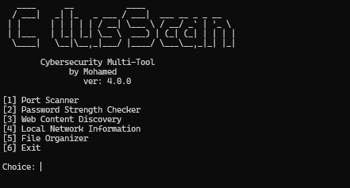

# CyberScan — Cybersecurity Multi-Tool (ver 4.0.0)



*[English below / الانجليزية تحت]*

---

## 🇬🇧 English

A simple Python script that bundles 5 security/networking utilities into a single CLI menu.

### Features

1. **Port Scanner** — scans a port range on a target IP/hostname (multi-threaded), showing each open port along with its detected service.
2. **Password Strength Checker** — analyzes a password (length, upper/lowercase, digits, symbols, entropy), detects common passwords, keyboard patterns (`qwerty`, etc.), sequences (`123456`, etc.) and character repetition, then gives a rating (VERY WEAK → VERY STRONG) with improvement tips.
3. **Web Content Discovery** — a mini gobuster/dirbuster: sends a GET request for every word in a wordlist to find folders/files on a target site (based on status codes like 200, 301, 403, etc.).
4. **Local Network Info** — shows the machine's hostname and local IP address.
5. **File Organizer** — automatically organizes files in a folder (e.g. Downloads) by category (Images, Videos, Audio, Documents, Archives, Programs, Others).

### Requirements

- Python 3.8+
- No extra libraries needed — everything is standard library (`socket`, `urllib`, `concurrent.futures`, `pathlib`, etc.)

### Installation

```bash
git clone https://github.com/med-ndr/multitool.git
cd multitool
python3 multitool.py
```

### Usage

```bash
python3 multitool.py
```

You'll see this menu:

```
[1] Port Scanner
[2] Password Strength Checker
[3] Web Content Discovery
[4] Local Network Information
[5] File Organizer
[6] Exit
```

Pick a number and follow the prompts (target, ports, wordlist path, etc.).

**Note on Web Content Discovery:** you'll need a wordlist (a `.txt` file, one word per line) to test against. Ready-made wordlists are available on [SecLists](https://github.com/danielmiessler/SecLists).

### Output

- Port Scanner: optionally saves results to `scan_results.txt` (append mode).
- Password Checker / Web Discovery / Network Info: results are printed to the terminal only.
- File Organizer: creates subfolders (Images, Videos, ...) and moves files into them.

.......
